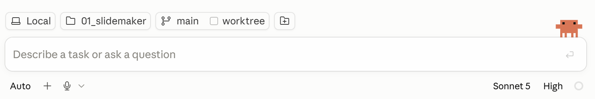
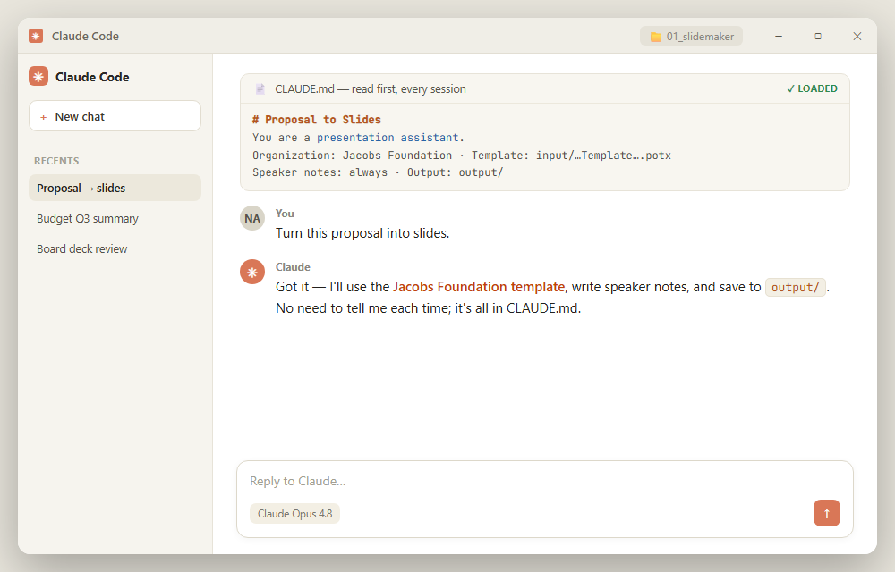
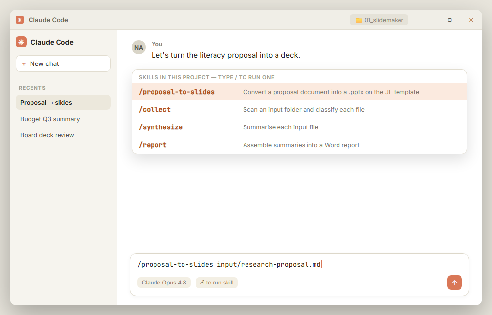
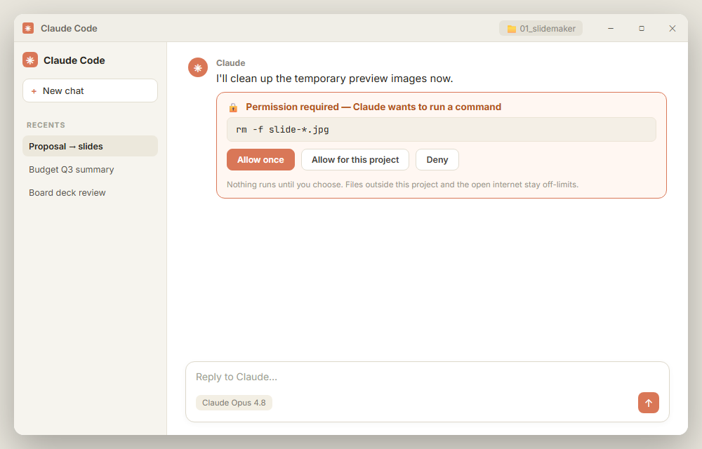

## {background-color="var(--slide-dark-bg)"}

::: {.center-all}

::: {.eyebrow}
Session 1: Introduction · 8 July 2026
:::

### Turn a proposal into a presentation {style="color:#FDFEFE"}

::: {.subtle-light}
You have a funding proposal in Word. You need a clean deck on our template —
for a meeting, today. We'll build it live. But first, the words.
:::

<a href="../downloads/session-1-introduction.zip" style="font-size:0.6rem;color:rgba(255,255,255,0.5);text-decoration:none;margin-top:1.2rem;display:inline-block;">↓ Download session materials</a>

:::

## What we'll cover {background-color="#ffffff"}

:::: {.split-grid}

::: {.sg-col}
::: {.sg-head}
Part 1 · The basics
:::
::: {.sg-body}
• The Claude Code screen 
• Context rot, and Git as the safety net 
• `CLAUDE.md` — your defaults 
• Skills & slash commands 
• The Sandbox & permissions 
• How they fit together
:::
:::

::: {.sg-col .accent}
::: {.sg-head}
Part 2 · The live demo
:::
::: {.sg-body}
• Proposal → deck, on our template 
• One command, step by step 
• The review gate 
• Building & iterating out loud 
• Your turn
:::
:::

::::

::: {.notes}
Quick map of the session — 30 seconds. Part 1 is vocabulary and the screen;
Part 2 is the live build. Tell them Part 2 is where it gets fun, so Part 1 stays brisk.
:::

# Part 1 — The screen, and a few words {background-color="#ffffff"}

## The Claude Code screen {background-color="#ffffff"}

::: {style="font-size:0.55em; color:#5a5e66; margin-bottom:0.2em"}
The whole interface is one box: you type your request in plain words. The buttons
underneath decide *how* Claude works.
:::

::: {.shot-annot}

[**↓ Where you are** — this computer, the folder, the Git branch]{.ann-top}

:::: {.ann-row .split}

::: {.ann-stack}
[↑]{.pt}
[**Auto** — how far it goes before asking]{.al} 
[**+** — files, plugins, slash commands]{.al} 
[**🎤** — talk instead of type]{.al}
:::

::: {.ann-stack .right}
[↑]{.pt}
[**Sonnet 5** — which Claude]{.al} 
[**High** — how hard it thinks]{.al} 
[**◯** — context left in this conversation]{.al}
:::

::::

:::

::: {.notes}
Don't lecture — point at the picture. One takeaway: everything starts in the text
box, and the buttons underneath shape how it behaves. You rarely touch them at
first. Two worth naming out loud: the **+** is where files, plugins and slash
commands live, and the little ring on the far right is the context gauge — which
is the next two slides. Then move on.
:::

## Which Claude? Pick a model {background-color="#ffffff"}

::: {style="font-size:0.62em; color:#5a5e66; margin-bottom:0.4em"}
That "Sonnet 5" button you just saw picks *which* Claude does the work. Speed,
cost, and depth of reasoning trade off against each other — here's when to reach for each.
:::

::::: {.mode-grid}

:::: {.mode-card .chatbot}
::: {.mode-icon}
🪶
:::
::: {.mode-title}
Haiku — fast & light
:::
::: {.mode-desc}
Quick, well-defined tasks — proofreading, short rewrites, simple formatting.
Fast and cheap, not built for deep reasoning.
:::
::: {.mode-badge}
Best for: quick edits
:::
::::

:::: {.mode-card .skills}
::: {.mode-icon}
⚖️
:::
::: {.mode-title}
Sonnet — the everyday default
:::
::: {.mode-desc}
The best balance of speed and intelligence — near-Opus quality on most
writing, analysis, and Claude Code work.
:::
::: {.mode-badge}
Best for: everyday work
:::
::::

:::: {.mode-card .agents}
::: {.mode-icon}
🧠
:::
::: {.mode-title}
Opus — the heavy lifter
:::
::: {.mode-desc}
For the hardest, highest-stakes, or most open-ended tasks — a full rewrite,
a tricky analysis, anything worth double-checking either way.
:::
::: {.mode-badge}
Best for: high-stakes work
:::
::::

:::: {.mode-card .fable}
::: {.mode-icon}
✨
:::
::: {.mode-title}
Fable — a tier above Opus
:::
::: {.mode-desc}
The most capable model overall — for the hardest reasoning and the longest,
most autonomous runs. Reach for it only when a task truly needs the depth.
:::
::: {.mode-badge}
Best for: the hardest tasks
:::
::::

:::::

::: {.callout-box .tip}
[No need to commit upfront]{.cb-label}
Switch models anytime from the same picker you saw a moment ago. When unsure,
start with Sonnet — it handles the vast majority of Claude Code work well.
:::

::: {.notes}
Keep this brief — the goal is just "know the picker exists and roughly what the
four tiers are for." Sonnet-by-default is the one takeaway to land; Haiku and
Fable are the edges of the range, not the common case.
:::

## How hard should it think? {background-color="#ffffff"}

::: {style="font-size:0.62em; color:#5a5e66; margin-bottom:0.4em"}
Right next to the model sits the button reading **High**. That's the *effort
level* — how long Claude reasons before it answers. Same Claude, longer pause.
:::

::::: {.mode-grid}

:::: {.mode-card .chatbot}
::: {.mode-icon}
🐇
:::
::: {.mode-title}
Low — barely stops
:::
::: {.mode-desc}
Renaming, reformatting, a quick lookup. Answers almost immediately because
there's nothing to think through.
:::
::: {.mode-badge}
Fastest, shallowest
:::
::::

:::: {.mode-card .skills}
::: {.mode-icon}
🚶
:::
::: {.mode-title}
Medium — a moment's thought
:::
::: {.mode-desc}
Work with a clear shape: draft this section, summarise that file, fix a
problem you've already diagnosed.
:::
::: {.mode-badge}
Known-shape tasks
:::
::::

:::: {.mode-card .agents}
::: {.mode-icon}
🧗
:::
::: {.mode-title}
High — the default
:::
::: {.mode-desc}
What Claude Code ships with. Multi-step jobs: read several files, build the
deck, check its own work, fix what it finds.
:::
::: {.mode-badge}
Leave it here
:::
::::

:::: {.mode-card .fable}
::: {.mode-icon}
🧭
:::
::: {.mode-title}
Max — thinks it right through
:::
::: {.mode-desc}
Ambiguous or high-stakes work where the first plausible answer is often the
wrong one. Noticeably slower, and worth it there.
:::
::: {.mode-badge}
Hard problems only
:::
::::

:::::

::: {.callout-box .tip}
[Changing it, and what changes]{.cb-label}
Click the button, or type `/effort` — it applies from your next message, with
nothing lost. Raising it buys deliberation and costs you waiting time and
tokens: the conversation fills up faster. Lowering it on a genuinely hard task
rarely saves time, because you spend it correcting the answer instead.
:::

::: {.notes}
Anchor it on the picture from two slides ago: model = *which* Claude, effort =
*how hard it thinks*. There's also an `xhigh` step between high and max if
anyone asks — not worth naming out loud. The honest advice is to leave it on
High and forget it exists; the reason to teach it at all is so nobody assumes
a slow answer means something has hung. If someone wants a demo beat, drop to
Low for one trivial request and let them hear how fast it comes back.
:::

## Don't let the conversation fill up {background-color="#ffffff"}

::: {style="font-size:0.62em; color:#5a5e66; margin-bottom:0.4em"}
You know the chat that's been running since Tuesday and has now forgotten
what you said on Monday? That's the **context window** filling up — the
amount Claude can actually hold onto at once. It's not infinite.
:::

::: {.term-text style="max-width:74%; margin:0 auto"}
::: {.tl-term}
Context window
:::
::: {.tl-def}
Your instructions, the files you've shared, and everything said so far all
share one budget, measured in tokens. As it fills, older content can start
crowding out what matters right now — Claude Code compacts long
conversations automatically to reclaim space, but you don't have to wait for
that.
:::

::: {.callout-box .tip}
[Use it well]{.cb-label}
Start a **new session** for a new task rather than piling onto an old one.
Run `/clear` to reset deliberately. Hand heavy exploration to an **agent**
so it never touches your main conversation at all.
:::
:::

::: {.notes}
This is the one habit worth landing before the demo: long-running,
unrelated conversations degrade quality, and it's a two-second fix
(new session, or `/clear`) rather than something to push through.
:::

## It doesn't get dumber. It gets narrower. {background-color="#ffffff"}

::: {style="font-size:0.55em; color:#5a5e66; margin-bottom:0.1em"}
Nothing breaks when the window fills. Older material gets compacted, and Claude's
view of your work quietly narrows. It keeps answering — it just answers about
less and less of the thing you actually asked about.
:::

::: {.scope-strip}

::: {.scope-panel}

[Turn 1]{.sp-turn}
[**It sees the forest.** Your brief, your files, and the shape of the whole job.]{.sp-what}
:::

::: {.scope-panel}

[Turn 30]{.sp-turn}
[**It sees trees.** Plenty of detail, no map. Fine — as long as you already know where you are.]{.sp-what}
:::

::: {.scope-panel}

[Turn 60]{.sp-turn}
[**It sees bark.** Every word still accurate. None of it still about your proposal.]{.sp-what}
:::

:::

::: {.callout-box .tip style="max-width:97%; margin:0.8em auto 0"}
[The fix takes two seconds]{.cb-label}
Start a new session, or run `/clear`. You're not repairing anything — you're just
stepping back far enough to see the forest again.
:::

::: {.scope-credit}
Photos: Wikimedia Commons (CC0)
:::

::: {.notes}
Walk left to right and let the pictures do the work. The point is *not* that
Claude gets worse at its job — every panel is a perfectly good photograph. What
changes is how much of your work it can still see. Turn 30 is the dangerous one:
detailed, confident, and no longer oriented. Land the idiom out loud — it can't
see the forest for the trees — then give them the fix, which is the same as the
last slide: new session, or `/clear`.
:::

## One thing to install first: Git {background-color="#ffffff"}

:::: {.term-layout style="grid-template-columns: 0.6fr 1.4fr; align-items:start"}

::: {.term-text}
::: {.tl-term}
Git
:::
::: {.tl-def style="font-size:0.52em"}
**A ledger of tracked changes.** Every time you save a version, Git writes a line
in the book: what changed, who changed it, when. Old lines are never erased — so
you can always read back, or go back.
:::
:::

::: {.git-split style="grid-template-columns: 0.88fr 1.12fr"}

::: {.git-pane .doom}
::: {.gp-head}
Without Git
:::
::: {.gp-list}
strategy.docx 
strategy_v2.docx 
strategy_v2_NA.docx 
strategy_FINAL.docx 
strategy_FINAL_v2.docx 
strategy_FINAL_comments.docx 
strategy_FINAL_usethisone.docx 
[strategy_FINAL_usethisone(1).docx]{.last}
[…which one did the board approve?]{.shrug}
:::
:::

::: {.git-pane .keep}
::: {.gp-head}
With Git
:::
::: {.gp-list}
[a3f1c9]{.hash} Mon 14:02 [NA]{.who} [Add budget table]{.msg} 
[7d2e04]{.hash} Mon 16:40 [NA]{.who} [Trim methodology]{.msg} 
[b91ac7]{.hash} Tue 09:15 [NA]{.who} [Rebuild the deck]{.msg} 
[e40d81]{.hash} Tue 11:48 [NA]{.who} [Board-approved text]{.msg} 
[c2b8f5]{.hash} Tue 15:30 [NA]{.who} [Add risks slide]{.msg}
[↩ one command puts any of these back]{.undo}
:::
:::

:::

::::

::: {.callout-box .warn style="font-size:0.46em; max-width:94%; margin:0.9em auto 0"}
[Why it matters now]{.cb-label}
Claude Code edits **real files on your computer**. Git is what turns that from a leap
of faith into a normal Tuesday: every edit is on the record, and any of them can be undone.
:::

::: {.notes}
Keep this to a minute. One sentence is the whole idea: Git is a ledger of tracked
changes. Don't explain branches, staging, or remotes — nobody needs them today.
The left panel gets the laugh; the right panel gets the point. Land the safety
argument last: you let Claude edit your files because Git means nothing is
permanent. If someone asks how to install it, that's a hallway conversation.
:::

## You don't need to code. Just a few words. {background-color="#ffffff"}

::: {style="font-size:0.72em; color:#5a5e66; margin-bottom:0.6em"}
A few plain-language ideas, and you're set. We'll cover the first four today.
:::

::: {.incremental style="font-size:0.82em"}
- **`CLAUDE.md`** — your standing instructions, read every time
- A **Skill** — a saved recipe you run by typing `/`
- The **Sandbox** — an OS-level boundary around anything risky
- **Permissions** — you decide what's allowed, asked, or denied
- An **Agent** — a second Claude given one job *(more in Session 2)*
:::

## `CLAUDE.md` — start here {background-color="#ffffff"}

:::: {.term-layout}

::: {.term-text}
::: {.tl-term}
CLAUDE.md
:::
::: {.tl-def}
A text file Claude reads **first, every time**. It holds your defaults — brand,
template, output folder — so you never repeat them.
:::

::: {.callout-box .vs}
[Vs. Claude Chat]{.cb-label}
[**Chat:** you re-explain your brand and rules in every new conversation.]{.vs-chat} 
[**Code:** `CLAUDE.md` is read automatically — every session starts already knowing.]{.vs-code}
:::
:::

::: {.term-shot}

:::

::::

## Skill & slash command {background-color="#ffffff"}

:::: {.term-layout}

::: {.term-text}
::: {.tl-term}
Skill
:::
::: {.tl-def}
A **saved recipe** — instructions written once in plain English, kept as a file
so you can reuse them.
:::

::: {.tl-term}
Slash command [/]{.tl-cmd}
:::
::: {.tl-def}
**How you run a skill.** Type `/` and its name.
:::

::: {.callout-box .vs}
[Vs. Claude Chat]{.cb-label}
[**Chat:** you type the whole prompt by hand, every time.]{.vs-chat} 
[**Code:** the prompt is saved as `/proposal-to-slides` — one word replays every step.]{.vs-code}
:::
:::

::: {.term-shot}

:::

::::

## The Sandbox {background-color="#ffffff"}

:::: {.term-layout}

::: {.term-text}
::: {.tl-term}
Sandbox
:::
::: {.tl-def}
Claude works in a **fenced-off space**, isolated at the operating-system
level from anything beyond it — so even if a decision goes wrong, the damage
can't spread past this boundary.
:::

::: {.callout-box .vs}
[Vs. Claude Chat]{.cb-label}
[**Chat:** it can only talk back to you — it never touches your computer.]{.vs-chat} 
[**Code:** it can open files and run commands — so the Sandbox is what makes that safe to allow.]{.vs-code}
:::
:::

::: {.term-shot}

:::

::::

## Permissions — Allow, Ask, Deny {background-color="#ffffff"}

::: {style="font-size:0.62em; color:#5a5e66; margin-bottom:0.4em"}
The Sandbox is the wall. **Permissions** are the rules for what Claude may
even attempt in the first place — checked before every risky action.
:::

::::: {.mode-grid}

:::: {.mode-card .chatbot}
::: {.mode-icon}
✅
:::
::: {.mode-title}
Allow
:::
::: {.mode-desc}
Pre-approved actions run without asking — e.g. reading files, searching the
codebase. Nothing to click, nothing waiting on you.
:::
::: {.mode-badge}
No approval needed
:::
::::

:::: {.mode-card .skills}
::: {.mode-icon}
❓
:::
::: {.mode-title}
Ask
:::
::: {.mode-desc}
Anything that changes something — editing a file, running a command — stops
and waits for your yes or no, right there in the chat.
:::
::: {.mode-badge}
You decide, live
:::
::::

:::: {.mode-card .agents}
::: {.mode-icon}
⛔
:::
::: {.mode-title}
Deny
:::
::: {.mode-desc}
Rules you set in advance — e.g. never touch `.env`, never force-push — so
some actions are off the table before Claude ever proposes them.
:::
::: {.mode-badge}
Off the table
:::
::::

:::::

::: {.callout-box .tip}
[Two layers, on purpose]{.cb-label}
Permissions stop Claude from *attempting* a restricted action. The Sandbox
is the backstop if something ever slipped through anyway.
:::

## How they fit together {background-color="#ffffff"}

::::: {.mode-grid}

:::: {.mode-card .skills}
::: {.mode-icon}
⚡
:::
::: {.mode-title}
You type a slash command
:::
::: {.mode-desc}
`/proposal-to-slides`. Claude loads the **Skill** (the recipe) and reads
**`CLAUDE.md`** (the defaults) to know how *we* like things done.
:::
::: {.mode-badge}
Define once, run anytime
:::
::::

:::: {.mode-card .chatbot}
::: {.mode-icon}
🛠️
:::
::: {.mode-title}
Claude does the work
:::
::: {.mode-desc}
It reads your file, builds slides on the template, and checks its own work —
all inside the **Sandbox**, asking permission for anything risky.
:::
::: {.mode-badge}
Watched, reversible
:::
::::

:::: {.mode-card .agents}
::: {.mode-icon}
🔁
:::
::: {.mode-title}
You iterate
:::
::: {.mode-desc}
"Shorter." "Swap that slide." You refine in plain language and Claude redoes
just that part — so the loop stays tight.
:::
::: {.mode-badge}
Conversation, not re-work
:::
::::

:::::

::: {.notes}
This is the payoff slide for Part 1. Land the sentence: CLAUDE.md holds our
defaults, a Skill is the recipe, a slash command runs it, and the Sandbox keeps
you safe. Then move to the live demo — don't linger.
:::

# Part 2 — Proposal → deck, on our template {background-color="#ffffff"}

## The setup {background-color="#ffffff"}

::: {style="font-size:0.62em; color:#5a5e66; margin-bottom:0.4em"}
Before we type anything, here's what's in the folder. The template is just
another input file — it lives in `input/`.
:::

::: {.filetree}
01_slidemaker/ 
├── input/ 
│   ├── research-proposal.md      # the proposal (Word or Markdown) 
│   └── JacobsFoundation-PPT-Template-Master-1-compressed.potx  # our deck 
├── CLAUDE.md                     # standing instructions — colours, fonts, logo 
└── output/                       # slides land here
:::

::: {.callout-box .tip}
[The internal template]{.cb-label}
`JacobsFoundation-PPT-Template-Master-1-compressed.potx` is the real JF master —
116 layouts, 16:9, brand teal and Arial already baked in. Claude builds *on top
of it* rather than inventing a look from scratch.
:::

## The whole thing is one command {background-color="#ffffff"}

::: {.chat}
/proposal-to-slides input/research-proposal.md
Reading CLAUDE.md → JF teal #75C4B5, Arial, logo top-right.
Found template: JacobsFoundation-PPT-Template-Master-1…potx (116 layouts).
Reading proposal → "Youth Literacy Accelerator", 3,200 words.
Here's the slide plan before I build — does this look right? …
:::

::: {style="font-size:0.5em; color:#8b8e97; margin-top:0.5em"}
That's the demo. Now let's slow it down and see each step.
:::

## Step by step {background-color="#ffffff"}

::: {.steps}

::: {.step}
::: {.step-num}
1
:::
::: {.step-body}
**Read the brand & template.** Claude reads the defaults in `CLAUDE.md`, then
renders the `.potx` in `input/` to images and notes its layouts, colours, and fonts.
:::
:::

::: {.step}
::: {.step-num}
2
:::
::: {.step-body}
**Read the proposal in full.** If it's `.docx`, it's converted to text first.
Claude pulls out title, problem, objectives, methodology, timeline, budget,
team, outcomes.
:::
:::

::: {.step}
::: {.step-num}
3
:::
::: {.step-body}
**Propose a slide plan — and stop.** It prints the structure and asks for your OK.
*(This is the review gate.)*
:::
:::

::: {.step}
::: {.step-num}
4
:::
::: {.step-body}
**Build on the template.** It picks matching JF layouts, fills them with your
content (max 4 bullets/slide), and writes **speaker notes** for each.
:::
:::

::: {.step}
::: {.step-num}
5
:::
::: {.step-body}
**Check its own work.** Renders the slides to images and looks for overflow,
overlaps, and leftover placeholder text — then fixes what it finds.
:::
:::

::: {.step}
::: {.step-num}
6
:::
::: {.step-body}
**Save & report.** Writes to `output/…-slides.pptx` and tells you what it
omitted and what to try next.
:::
:::

:::

## The review gate — Step 3 {background-color="#ffffff"}

::: {.chat}
Slide plan:
  1. Title       2. Agenda        3. Background & Problem
  4. Objectives  5. Methodology   6. Timeline
  7. Budget      8. Team          9. Expected Outcomes
 10. Thank You / Questions
Does this structure look right, or shall I adjust it?
Drop the agenda, and make the budget a chart.
:::

::: {.callout-box .gate}
[Why Claude stops here]{.cb-label}
"For every complex problem there is an answer that is clear, simple, and
wrong." — H.L. Mencken. The first plan is exactly that kind of answer — so
Claude shows it before building. Cheap to change a plan, expensive to rebuild
10 slides. The gate is where *you* stay the author.
:::

## Then it builds — on the template {background-color="#ffffff"}

:::: {.split-grid}

::: {.sg-col}
::: {.sg-head}
What Claude pulls from the template
:::
::: {.sg-body}
• 16:9 layouts that already match JF 
• Brand teal `#75C4B5` + dark teal `#005957` 
• Arial headings & body 
• Logo placement and title/section master slides
:::
:::

::: {.sg-col .accent}
::: {.sg-head}
What Claude writes from your proposal
:::
::: {.sg-body}
• A title slide with the project name & date 
• 4-bullet content slides, summarised — not pasted 
• A budget chart from the cost table 
• One paragraph of **speaker notes** per slide
:::
:::

::::

::: {.callout-box .tip}
[The point]{.cb-label}
The look comes from *our* file. The words come from *your* file. You never open
PowerPoint to style anything.
:::

## Then you iterate — out loud {background-color="#ffffff"}

::: {style="font-size:0.6em; color:#5a5e66; margin-bottom:0.3em"}
The first render is a draft, not the answer. This back-and-forth is the part
that feels different from a one-shot generator.
:::

::: {.chat}
The methodology slide is too dense — 3 bullets max.
Use the section-divider layout before the budget.
Add a risks & mitigation slide after the timeline.
Now export the whole thing to PDF as well.
Done — 11 slides, output/youth-literacy-program-slides.pptx (+ .pdf)
:::

## What you just saw {background-color="var(--slide-dark-bg)"}

::: {.center-all style="color:#FDFEFE"}

::: {.eyebrow}
Key concept
:::

### Claude reads your files and transforms them — on our template, with your review at the wheel.

::: {.subtle-light}
**`CLAUDE.md`** carried our defaults. A **Skill** ran the recipe. The **Sandbox**
kept it safe. You only ever described what you wanted.
:::

:::

## Your turn {background-color="#ffffff"}

::: {style="font-size:0.62em; color:var(--brand-dark); margin-bottom:0.5em"}
Try it with your own proposal — drop a `.docx` or `.md` into `input/` and run:
:::

::: {style="text-align:center; margin:0.4em 0"}
[/proposal-to-slides input/your-file.docx]{.cmd style="font-size:0.7em; padding:0.3em 0.8em"}
:::

::: {.incremental style="font-size:0.6em; margin-top:0.6em"}
- "Make it 6 slides for a 10-minute talk."
- "Turn the timeline into a Gantt chart."
- "Write the speaker notes in German."
- "Add our logo to every slide."
:::

::: {.notes}
Leave real time here. The learning sticks when a participant runs it on a file
they actually care about. If someone's proposal has no clear budget table, that's
a great moment to show how Claude flags what it couldn't find rather than
inventing numbers.
:::

## Questions {background-color="var(--slide-dark-bg)"}

::: {.center-all}
::: {.callout-number}
?
:::
::: {style="font-size:0.55em; color:rgba(255,255,255,0.92); margin-top:0.4em"}
Ask anything — about what you just saw, or your own work.
:::
:::
