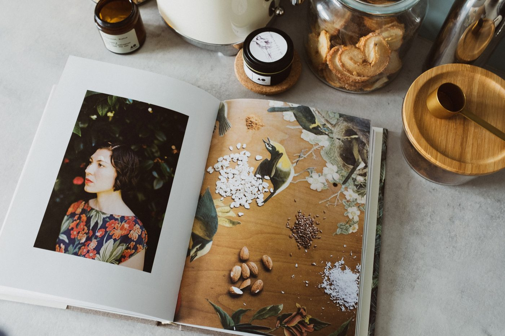

## {background-color="var(--slide-dark-bg)"}

::: {.center-all}

::: {.eyebrow}
Session 2: Skills and Agents · 9 July 2026
:::

### Turn a pile of mixed documents into one report {style="color:#FDFEFE"}

::: {.subtle-light}
Meeting notes, a spreadsheet, field reports, a couple of PDFs. Ten files, four formats, one deadline. You need a single summary a decision-maker will actually read. Three small skills, chained, do it.
:::

:::

## What we'll cover {background-color="#ffffff"}

:::: {.split-grid}

::: {.sg-col}
::: {.sg-head}
Part 1 · The idea
:::
::: {.sg-body}
• Recap: `CLAUDE.md` & skills 
• Skills chain into a pipeline 
• Each step writes a file 
• **Agents** run the work inside each step — in parallel 
• Check or re-run any step on its own
:::
:::

::: {.sg-col .accent}
::: {.sg-head}
Part 2 · The live run
:::
::: {.sg-body}
• `/collect` → classify the files 
• `/synthesize` → agents, one per file type, all at once 
• `/report` → the review gate 
• Add a file, re-run just one step 
• Your turn
:::
:::

::::

::: {.notes}
Same 30-second map as Session 1. Part 1 is one idea — skills hand files to each
other. Part 2 is the live run. Tell them Part 1 is a quick recap so it stays
brisk; the pipeline is where it gets fun.
:::

# Part 1 — One idea: skills compose {background-color="#ffffff"}

## Recap from Session 1 {background-color="#ffffff"}

::: {style="font-size:0.7em; color:#5a5e66; margin-bottom:0.6em"}
You already met these. Same words, new job.
:::

::: {.term-grid}

::: {.term-card}
::: {.term-name}
Skill [/collect]{.term-cmd}
:::
::: {.term-def}
A saved recipe you run with a slash command.
:::
::: {.term-eg}
Session 1 had one skill. This session has three — built to hand off to each other.
:::
:::

::: {.term-card}
::: {.term-name}
CLAUDE.md
:::
::: {.term-def}
The standing instructions Claude reads first.
:::
::: {.term-eg}
Ours sets the defaults: output is a `.docx`, English, numbered headings, max 10 pages.
:::
:::

:::

## The new idea: a pipeline {background-color="#ffffff"}

::: {style="font-size:0.72em; color:#5a5e66; margin-bottom:0.5em"}
Each skill leaves a file for the next one to pick up. Three skills chained together
give you a pipeline — each step small enough to check on its own.
:::

:::: {.pipeline-strip}
::: {.pipeline-card .input}
[Input]{.pc-step}

[Your files]{.pc-title}

[notes · sheets · PDFs]{.pc-meta}
:::

::: {.pipeline-link}
[/collect]{.pc-cmd}

[→]{.pc-arrow}
:::

::: {.pipeline-card .handoff}
[Saved handoff]{.pc-step}

[manifest.md]{.pc-title}

[file types]{.pc-meta}
:::

::: {.pipeline-link}
[/synthesize]{.pc-cmd}

[→]{.pc-arrow}
:::

::: {.pipeline-card .handoff}
[Saved handoff]{.pc-step}

[summaries/]{.pc-title}

[1 summary / input]{.pc-meta}
:::

::: {.pipeline-link}
[/report]{.pc-cmd}

[→]{.pc-arrow}
:::

::: {.pipeline-card .output}
[Final output]{.pc-step}

[report.docx]{.pc-title}

[final draft]{.pc-meta}
:::
::::

::: {.callout-box .tip}
[Run any step on its own]{.cb-label}
Run each step alone, or fire all three with `/summarizer`. Change a file — re-run only that step. Nothing else changes.
:::

::: {.notes}
This is the payoff slide for Part 1 — land one sentence: a skill leaves a file the
next skill picks up, so the pipeline is three small steps, not one big prompt.
Then move straight to the live run — don't linger on the diagram.
:::

## Why three skills, not one? {background-color="#ffffff"}

::: {style="font-size:0.68em; color:#5a5e66; margin-bottom:0.2em"}
Small steps you can check beat one big step you have to trust.
:::

::: {.incremental style="font-size:0.72em; margin-top:0.8em"}
- **Inspect** — open intermediate files between steps; see exactly what happened
- **Re-run** — add a file, re-run only what changed
- **Trust** — one thing at a time is easy to verify
- **Gate** — the review pause belongs at a step boundary, not buried mid-prompt
:::

::: {.notes}
This slide answers the question participants almost always ask: "why not just one big prompt?"
Land the contrast: one big prompt collapses three failure modes into one opaque output.
:::

## Skills vs. agents {background-color="#ffffff"}

::: {style="font-size:0.68em; color:#5a5e66; margin-bottom:0.5em"}
Same assistant. Two different modes of working.
:::

:::: {.split-grid}

::: {.sg-col}
::: {style="border:1px solid #d7dbe2; border-radius:18px; overflow:hidden; background:#ffffff; box-shadow:0 10px 24px rgba(25,33,48,0.08)"}
{fig-alt="Open recipe book in a kitchen" style="display:block; width:100%; height:175px; object-fit:cover; margin:0"}

::: {style="padding:0.55em 0.8em 0.7em 0.8em; text-align:left"}
[Skill = recipe book]{style="font-size:0.78em; font-weight:800; color:var(--brand-dark)"}

[The saved instructions you keep coming back to.]{style="font-size:0.58em; color:#5a5e66"}
:::
:::
:::

::: {.sg-col .accent}
::: {style="border:1px solid #d7dbe2; border-radius:18px; overflow:hidden; background:#ffffff; box-shadow:0 10px 24px rgba(25,33,48,0.08)"}
{fig-alt="Ratatouille cooks working in a kitchen" style="display:block; width:100%; height:175px; object-fit:cover; margin:0"}

::: {style="padding:0.55em 0.8em 0.7em 0.8em; text-align:left"}
[Agents = cooks cooking]{style="font-size:0.78em; font-weight:800; color:var(--brand-dark)"}

[Each gets one tray, does one job, returns one result.]{style="font-size:0.58em; color:#5a5e66"}
:::
:::
:::

::::

<table style="width:100%; font-size:0.49em; border-collapse:collapse; margin-top:0.45em">
<thead>
  <tr style="background:var(--brand-dark); color:#ffffff">
    <th style="padding:0.55em 0.9em; text-align:left; width:20%; font-weight:600"></th>
    <th style="padding:0.55em 0.9em; text-align:left; width:40%; font-weight:600">Skill &nbsp;/collect · /synthesize · /report</th>
    <th style="padding:0.55em 0.9em; text-align:left; width:40%; font-weight:600">Agent &nbsp;spawned inside a skill</th>
  </tr>
</thead>
<tbody>
  <tr style="background:#f7f8fa">
    <td style="padding:0.5em 0.9em; color:#5a5e66; font-weight:700">Runs in</td>
    <td style="padding:0.5em 0.9em">Your conversation — full history available</td>
    <td style="padding:0.5em 0.9em">A fresh workspace — no prior context</td>
  </tr>
  <tr>
    <td style="padding:0.5em 0.9em; color:#5a5e66; font-weight:700">Talks back?</td>
    <td style="padding:0.5em 0.9em">Yes — can ask questions, show drafts, wait for you</td>
    <td style="padding:0.5em 0.9em">No — returns one result when done</td>
  </tr>
  <tr style="background:#f7f8fa">
    <td style="padding:0.5em 0.9em; color:#5a5e66; font-weight:700">Knows about</td>
    <td style="padding:0.5em 0.9em">Everything discussed so far</td>
    <td style="padding:0.5em 0.9em">Only what you explicitly hand it</td>
  </tr>
  <tr>
    <td style="padding:0.5em 0.9em; color:#5a5e66; font-weight:700">Point of view</td>
    <td style="padding:0.5em 0.9em">Familiar — has seen your work being built</td>
    <td style="padding:0.5em 0.9em">Fresh — like a colleague handed only the file</td>
  </tr>
  <tr style="background:#f7f8fa">
    <td style="padding:0.5em 0.9em; color:#5a5e66; font-weight:700">Best for</td>
    <td style="padding:0.5em 0.9em">Iteration, review gates, anything that needs your input</td>
    <td style="padding:0.5em 0.9em">Parallel work, scale — ten files as fast as one</td>
  </tr>
</tbody>
</table>

::: {.notes}
Land one sentence: a skill is the recipe, an agent is the worker. The "point of view"
row is the most compelling — agents don't have self-bias because they weren't in the
room when you wrote it. That matters for review steps. One pass here, then show it
live in the /synthesize demo.
:::

# Part 2 — Run the pipeline {background-color="#ffffff"}

## The setup {background-color="#ffffff"}

::: {.filetree}
02_summarizer/ 
├── sample-inputs/   # 10 files · 4 types — drop your own here 
│   ├── meeting notes ×3   .md 
│   ├── data files ×3      .md · .csv · .csv 
│   ├── literature ×3      .md 
│   └── field report ×1    .md 
├── CLAUDE.md        # defaults: .docx, 10 pages, numbered headings 
└── output/         # manifest, summaries, final report
:::

::: {.callout-box .tip}
[Supported types]{.cb-label}
`.md` · `.txt` · `.pdf` · `.docx` · `.csv` · `.xlsx` — mix freely. Claude reads
each in the way that fits it.
:::

## Step 1 — /collect {background-color="#ffffff"}

::: {style="font-size:0.56em; color:#5a5e66; margin-bottom:0.2em"}
Claude reads each file and labels it before going any deeper. The label decides how it will be read in the next step.
:::

::: {.chat}
/collect
MANIFEST — 10 files across 4 types
────────────────────────────────────────
meeting-notes  (×3)  01 · 04 · 05
data           (×3)  02 · 06 · 07
literature     (×3)  03 · 08 · 09
field-report   (×1)  10
0 flagged → saved output/manifest.md
:::

::: {.callout-box .tip}
[Teaching moment]{.cb-label}
Run this step alone first. Participants are surprised Claude labels a CSV as
`data` and a coach report as `field-report` — without being told.
:::

## Step 2 — /synthesize {background-color="#ffffff"}

::: {style="font-size:0.58em; color:#5a5e66; margin-bottom:0.3em"}
Each type gets its **own** reading lens — and `/synthesize` spawns one agent per
type so all 10 files are read in parallel.
:::

:::: {.parallel-flow}
::: {.pf-box .pf-source}
[Step input]{.pf-kicker}

[manifest.md · 10 files]{.pf-title}
:::

::: {.pf-badge}
4 agents, one per type
:::

:::: {.parallel-grid}
::: {.parallel-card .meeting}
[meeting-notes ×3]{.parallel-label}

[Decisions & actions]{.parallel-name}
:::

::: {.parallel-card .data}
[data ×3]{.parallel-label}

[Metrics & patterns]{.parallel-name}
:::

::: {.parallel-card .lit}
[literature ×3]{.parallel-label}

[Claims & caveats]{.parallel-name}
:::

::: {.parallel-card .field}
[field-report ×1]{.parallel-label}

[Context & examples]{.parallel-name}
:::
::::

::: {.pf-box .pf-output}
[summaries/ · 10 files]{.pf-title}
:::
::::

## Step 3 — /report, with a gate {background-color="#ffffff"}

::: {.chat}
/report
PROPOSED REPORT STRUCTURE
  1. Executive Summary       4. Evidence from Literature
  2. Decisions & Actions     5. Flagged Items for Review
  3. Field Observations & Data
Does this structure work? Adjust, add, or remove — reply "go" to confirm.
Add a "Recommendations" section before Flagged Items. Go.
:::

::: {.callout-box .gate}
[The human review gate]{.cb-label}
Claude shows the skeleton and **waits**. Automation without review is how errors
slip into official reports. Pause here in the demo and say exactly that.
:::

## The full pipeline in one line {background-color="#ffffff"}

::: {style="text-align:center; margin:0.3em 0"}
[/summarizer sample-inputs/]{.cmd style="font-size:0.72em; padding:0.3em 0.9em"}
:::

:::: {.summary-rail}
::: {.sr-step .collect}
[1]{.sr-num}

[/collect]{.sr-cmd}

[Classify the incoming files]{.sr-title}

[Sort the mixed inputs into the types Claude will read next.]{.sr-desc}

[manifest.md]{.sr-output}
:::

::: {.sr-link}
[hands off]{.sr-text}

[→]{.sr-arrow}
:::

::: {.sr-step .synth}
[2]{.sr-num}

[/synthesize]{.sr-cmd}

[Read by type, in parallel]{.sr-title}

[Spawn one agent per file type and write summaries as it goes.]{.sr-desc}

[summaries/]{.sr-output}
:::

::: {.sr-link .review}
[pause for your review]{.sr-text}

[→]{.sr-arrow}
:::

::: {.sr-step .report}
[3]{.sr-num}

[/report]{.sr-cmd}

[Propose the report, then wait]{.sr-title}

[Show the structure, take your edits, then draft the final document.]{.sr-desc}

[report.docx]{.sr-output}
:::
::::

::: {style="font-size:0.5em; color:#8b8e97; margin-top:0.2em; text-align:center"}
Same three skills — fired in sequence, still pausing at the gate.
:::

## Add a file and re-run {background-color="#ffffff"}

:::: {.split-grid}

::: {.sg-col}
::: {.sg-head}
The slow way
:::
::: {.sg-body}
Re-read everything, re-summarise everything, rebuild the whole report from
scratch every time one input changes.
:::
:::

::: {.sg-col .accent}
::: {.sg-head}
The pipeline way
:::
::: {.sg-body}
Drop 04-budget.xlsx into `sample-inputs/`, re-run
`/collect` and `/synthesize` (seconds), then `/report`. Only the new file is
fresh work.
:::
:::

::::

::: {.callout-box .tip}
[Why this matters]{.cb-label}
Reports are living documents. Because each step writes a file, you can re-enter
the pipeline at any point instead of starting over.
:::

## What you just saw {background-color="var(--slide-dark-bg)"}

::: {.center-all style="color:#FDFEFE"}

::: {.eyebrow}
Key concept
:::

### Skills compose. Agents parallelize.

::: {.subtle-light}
Small, single-purpose skills that hand files to each other define the pipeline.
Agents do the parallel work inside each step. Together: a process that is easy
to trust, inspect, and re-run — with a human in the loop where it counts.
:::

:::

::: {.notes}
The payoff for the whole session. Land the sentence: small skills that hand files
to each other beat one giant prompt. Then hand it to them — the learning sticks
when they run the pipeline on their own mix of files.
:::

## Your turn {background-color="#ffffff"}

::: {style="font-size:0.62em; color:var(--brand-dark); margin-bottom:0.4em"}
Drop your own mix of files into `sample-inputs/` and run the pipeline:
:::

::: {.incremental style="font-size:0.6em; margin-top:0.5em"}
- Mix a PDF, a spreadsheet, and some notes — watch `/collect` sort them.
- Add 5 more files and re-run `/synthesize` — watch agents spawn, one per type.
- "Translate the executive summary to French."
- "Make the flagged-items section a table."
:::

::: {.notes}
After /synthesize, open one of the intermediate summaries before running /report
— participants are always surprised the in-between files exist. The flagged-items
block is the trust story: show what Claude marked uncertain and trace it to the
source file.
:::

## Questions {background-color="var(--slide-dark-bg)"}

::: {.center-all}
::: {.callout-number}
?
:::
::: {style="font-size:0.55em; color:rgba(255,255,255,0.92); margin-top:0.4em"}
Ask anything — about what you just saw, or your own work.
:::
:::
